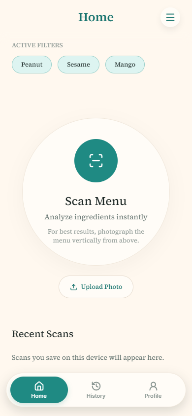
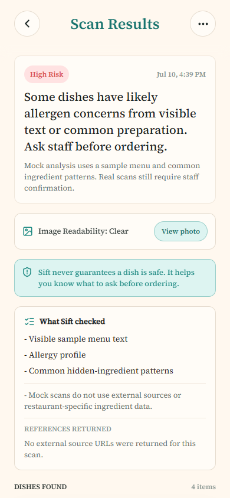
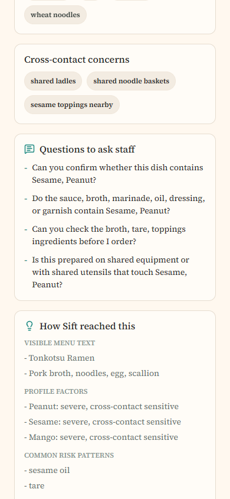

# Sift

**Know what to ask before you eat.**

Sift is an experimental mobile app built to help people with food allergies navigate unfamiliar restaurant menus. It combines a personal allergy profile with menu photos to highlight possible ingredient and cross-contact concerns, explain uncertainty, and suggest questions to ask restaurant staff.

The idea behind Sift is simple: **a menu scan should help you ask better questions, not promise that a dish is safe.**

> **Project status:** Sift is no longer in active development. This repository is shared as a record of the product, its design, and its technical approach—not as an actively maintained or validated food-safety service.

## A look at Sift

<p align="center">
  
  
  
</p>

<p align="center"><sub>App interface captures using a fictional profile and controlled demo data. These screens illustrate the experience, not measured AI accuracy.</sub></p>

## What it does

- **Personal allergy profiles.** Record allergens, severity, custom notes, and sensitivity to cross-contact.
- **Menu scanning.** Take photos or select up to four menu pages from your library for a single scan.
- **Dish-by-dish guidance.** Review possible listed allergens, common hidden-ingredient patterns, preparation concerns, and the reasoning behind each flag.
- **Uncertainty made visible.** Unreadable text, missing ingredient details, and other unknowns are surfaced rather than presented as definite answers.
- **Questions for staff.** Generate practical questions and restaurant-facing messages, with multilingual support and optional speech playback in supported flows.
- **Saved scans.** Revisit, rename, and remove scan results stored locally in the app.

## How it works

1. **Set up a profile** with your allergies and preferences.
2. **Photograph or upload a menu**—including multiple pages when needed.
3. **Explore the results** to see potential concerns and what the scan cannot establish.
4. **Confirm with restaurant staff** before deciding what to order.

Sift was designed as a decision-support tool for diners, caregivers, and families—not an automated food-safety verdict.

## Built with

- **Expo, React Native, and TypeScript** for the mobile experience.
- **Supabase** for authentication, server-side menu analysis, and request controls.
- **Multimodal AI** for interpreting menu images, with structured output validation and conservative risk-policy checks.
- **AsyncStorage** for on-device profiles and scan history.
- **Astro** for the accompanying product website in [`website/`](website/).

The repository also contains evaluation tools, benchmark fixtures, and reliability documentation. These are engineering and research artifacts; their presence does **not** mean the AI passed a production-level food-allergy safety evaluation.

## Explore the project locally

You can run the interface in its built-in **mock analysis mode** without configuring a live AI provider:

```bash
git clone https://github.com/exterminatorrat/Sift.git
cd Sift
npm install
cp .env.example .env
npm start
```

Follow the Expo CLI instructions to open the app on a supported simulator or device. You can also use `npm run ios`, `npm run android`, or `npm run web` for the corresponding development target.

The example configuration defaults to `EXPO_PUBLIC_ANALYSIS_MODE=mock`. **Mock mode uses a predefined sample menu; it does not analyze the menu photo you supply.** Live analysis requires separately configuring a Supabase project, deploying its Edge Function, and setting server-side provider credentials. See [the authentication setup guide](docs/authentication-production-setup.md) and [reliability architecture](docs/ai-reliability-architecture.md). Never place provider API keys or Supabase service-role secrets in `EXPO_PUBLIC_*` variables.

For a static type check:

```bash
npm run typecheck
```

The separate [website](website/) can be explored with `cd website && npm install && npm run dev`.

## Important safety limitations

**Sift cannot determine whether a food is safe to eat.** A photograph of a menu cannot verify a complete ingredient list, recipe substitutions, shared equipment, kitchen procedures, or cross-contact. AI output may be incomplete or wrong, including for severe allergies.

Always confirm relevant ingredients and preparation details directly with restaurant staff. If adequate confirmation is not possible, do not rely on a low-concern result from the app. Sift does not replace professional medical advice or an individual's allergy-management plan.

The project's [AI reliability report](docs/ai-reliability-report.md) explicitly documents uncompleted model-quality evaluation and release gates. No accuracy or safety guarantee is claimed here.

## More about the project

- [Product concept and principles](PRODUCT.md)
- [Design system](DESIGN.md)
- [AI reliability architecture](docs/ai-reliability-architecture.md)
- [AI evaluation notes](docs/ai-evals/README.md)
- [Website documentation](website/README.md)

---

Sift is shared to document an exploration of more transparent, careful AI assistance in everyday decisions. It is not in active development, and no ongoing maintenance or support is promised.

**License:** No license file is currently included. Public visibility alone does not grant permission to reuse, modify, or redistribute the code.
