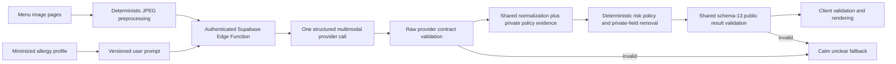

# Sift AI Reliability Architecture

Status: implemented architecture; model-quality gate pending; no launch-readiness claim

This document is the engineering plan and file map for making Sift's menu analysis measurable, conservative, and repeatable. It does not claim that Sift can determine whether food is safe. Menu text cannot establish complete ingredients, substitutions, preparation, or cross-contact, so staff confirmation remains part of the product contract.

## Success Definition

The architecture is successful when:

- the same versioned prompt, schema, ontology, policy, normalization, and safety rules are used by runtime analysis and evaluation;
- readable menu observations are kept separate from recipe or preparation inference;
- deterministic policy can preserve or raise caution but never lower it;
- malformed, unsupported, or weak evidence becomes a calm `unclear` result;
- development data can drive iteration without contaminating the final holdout;
- every reported metric has a saved denominator, configuration identity, and limitation;
- model evidence, deployed integration evidence, and human translation review remain separate.

## Runtime Architecture

### 1. Inputs

The app prepares ordered menu pages as JPEG images with a 1,600-pixel maximum long edge and quality `0.72`. The user payload contains allergy name, severity, cross-contact preference, optional custom details, user language, and requested restaurant language. It excludes profile names, profile IDs, allergy IDs, benchmark labels, and expected answers.

Relevant files:

- `src/services/imageService.ts`
- `supabase/functions/_shared/ai/prompts.mjs`
- `scripts/prepare-ai-eval-images.py`

### 2. Prompt Contract

The system prompt orders the work explicitly:

1. judge image quality;
2. record visible observations;
3. separate common patterns and uncertainty;
4. assess only the user's listed allergens;
5. generate practical communication for staff.

Readable dishes must include observable menu evidence, common-risk patterns, and uncertainty. Footnotes, legends, modifiers, and menu-wide notes count only when their connection to a dish is visible. The prompt forbids food-safety guarantees, hidden chain-of-thought, invented citations, and transferring an allergen between neighboring dishes without evidence.

Restaurant language can be requested explicitly. `Not sure` becomes an inference mode; the model may infer a language only when visible text supports it and otherwise falls back conservatively.

Each accepted scan makes at most one provider inference call. The runtime does not retry provider failures; a timeout, rate limit, provider error, malformed response, or failed safety contract becomes a calm `unclear` result. This keeps latency, cost, and evaluation denominators unambiguous.

Relevant file:

- `supabase/functions/_shared/ai/prompts.mjs`

### 3. Schema And Evidence

The provider schema is stricter than free-form JSON and is sent through each provider's supported structured-output field, including NVIDIA's `response_format.json_schema`. The current provider and public schema version is `13`. The provider response must contain one ordered page assessment per input image and classify each page as a dish listing, supporting information, or unusable/unknown. Every readable dish-listing page must contribute at least one source-attributed dish; readable covers, allergen legends, and menu-wide notes may contribute none and cannot be converted into invented dishes merely for page coverage. Each readable dish must expose:

- visible menu text;
- common risk patterns;
- uncertainties;
- possible profile allergens;
- hidden-risk ingredients;
- cross-contact concerns;
- a short reason;
- source page numbers;
- staff questions in the restaurant language and user language.

The provider response is validated before normalization. Validation requires dish-listing page completeness, profile-scoped evidence, explicit uncertainty escalation, profile-bound questions, and restaurant messages that preserve the supplied allergy names and severities. Requested and reported language metadata must agree, translation presence must be internally consistent, and non-Latin communication channels must contain the expected script. This lightweight script check does not replace human translation review for Latin-script languages. Validation also rejects model-labeled direct or derivative evidence unless visible text and the curated ontology support it. This prevents normalization from inventing missing evidence and making an incomplete answer look complete. Provider-only page classification is deliberately removed during normalization so the public `ScanResult` remains backward-compatible; the public and client validators still require every returned readable dish to carry valid source-page attribution. After normalization and policy, the Edge Function uses the shared public validator in `public-validation.mjs` as the authoritative server wire contract. The client validator remains a defensive, backward-compatible normalizer for saved local data; contract self-tests exercise both and document intentional differences such as timestamp repair and unsafe-reference filtering on legacy records.

Provider integration reference: [NVIDIA NIM structured generation](https://docs.nvidia.com/nim/vision-language-models/1.0.0/structured-generation.html).

Relevant files:

- `supabase/functions/_shared/ai/schemas.mjs`
- `supabase/functions/_shared/ai/provider-validation.mjs`
- `supabase/functions/_shared/ai/public-validation.mjs`

### 4. Ontology

The ontology is data, not prompt prose. Terms have a canonical allergen, language, relationship, confidence, risk floor, and source URLs. Relationship types are deliberately distinct:

- `direct_name`: the allergen itself is visibly named;
- `contains_allergen`: a clear derivative, such as tahini for sesame;
- `common_recipe_pattern`: a relevant common pattern that still needs confirmation;
- `ambiguous_association`: possible but not direct proof, such as mole without an ingredient list;
- `preparation_risk`: fryer, broth, batter, sauce, oil, marinade, or equipment uncertainty.

Direct and containing terms can support high or avoid floors. Common and ambiguous patterns normally support `ask_staff`, not a direct-ingredient claim. The curated ontology covers 12 allergen families across the 11 supported runtime languages and carries explicit language metadata. Custom details do not expand allergen identity through raw substring matching; unmatched custom allergens remain available to the model as profile context. Ontology terms and menu evidence use one Unicode normalization function so composed accents and non-Latin scripts are compared consistently.

Relevant file:

- `supabase/functions/_shared/ai/ontology.mjs`

### 5. Deterministic Risk Policy

The policy evaluates normalized evidence and profile severity after the model response. It keeps visible text, model-reported possible allergens, hidden ingredients, and cross-contact concerns as separate channels. Normalization preserves validated direct-allergen and derivative observations in a private `__policyEvidence` handoff; policy consumes it and removes it before public validation, telemetry, or rendering. This prevents observed evidence from being discarded during conversion to the public result shape.

Policy behavior includes:

- a directly visible or containing term under a severe allergy floors at `avoid_unless_confirmed`;
- the same evidence under mild or moderate severity floors at `high_risk`;
- common patterns, ambiguous associations, and preparation uncertainty floor at `ask_staff`;
- a model-reported possible profile allergen cannot remain `low_risk`;
- matching hidden ingredients and cross-contact concerns apply their own conservative floors without being relabeled as visible menu evidence;
- severe or cross-contact-sensitive uncertainty cannot remain reassuring;
- explicit provider uncertainty cannot remain `low_risk`;
- poor or materially incomplete images become `unclear` with retake guidance;
- unrelated neighboring dishes are not escalated merely because another dish lists an allergen.

The policy is monotonic: it may raise caution but cannot lower a model risk. Overall risk is derived deterministically rather than from dish order; `unclear` remains a non-ordinal outcome and cannot be silently compared as equivalent to an ordinal risk.

Relevant file:

- `supabase/functions/_shared/ai/risk-policy.mjs`

### 6. Normalization And Safety Language

Normalization converts provider fields into the public `ScanResult` shape without manufacturing observed text. Safety-language validation rejects explicit guarantees and equivalent reassurance in supported languages. Low-risk output must still contain visible-text or staff-confirmation uncertainty. Effective poor-image status is computed before dish policy so a server-inferred poor image cannot retain a `low_risk` dish.

Relevant files:

- `supabase/functions/_shared/ai/normalization.mjs`
- `supabase/functions/_shared/ai/safety-language.mjs`
- `supabase/functions/_shared/ai/public-validation.mjs`
- `src/utils/scanResultValidation.ts`

### 7. Configuration Identity

Every candidate fingerprints:

- provider and exact model;
- thinking level and output-token limit;
- provider-specific wire settings such as reasoning effort, temperature, grounding, structured-output mode, API surface, timeout, and the no-provider-retry policy;
- system prompt;
- canonical provider schema, effective wire schema, and public schema;
- risk policy;
- ontology;
- normalization;
- safety-language rules;
- image preprocessing.

A changed fingerprint starts a new run. Results with mixed identities cannot be pooled.
Manual-provider and deployed-Edge runs keep distinct identities because only the deployed path includes network transport settings. They may be compared, but their metrics are never merged into one model-quality denominator.

Relevant file:

- `supabase/functions/_shared/ai/configuration.mjs`

## Benchmark Architecture

### Development Split

`development-v1.json` contains 60 image cases in 23 menu groups. It is used for prompt, schema, ontology, policy, evaluator, and annotation development. Because it influences those decisions, its scores are diagnostic rather than an unbiased launch claim.

### Candidate Holdout

`holdout-v1.json` contains 48 synthetic cases in 24 independent groups with no case or group overlap with development. Its languages are Traditional Chinese, Vietnamese, Turkish, Polish, Indonesian, and Dutch, with four groups per language and two cases per group. Twelve cases form a predeclared cross-language slice: one two-case group per menu language uses English as the user's language while preserving the menu language as the restaurant language. The candidate corpus SHA-256 is `426df50420a7364149a96963cc7a181e2d007ddeca9e6200acc399f8149ac2e6`.

All labels are currently pending human review, so this is a candidate rather than a frozen holdout and it has zero current live responses. The all-synthetic candidate is intentionally unpromotable. Promotion cannot be achieved by editing status, supplying a smaller expected count, or choosing a substitute development manifest. It requires the fixed 48-case / 24-group contract, exactly 12 reviewed real-world cases across the six predeclared groups, a completed source-acquisition receipt, per-case source/output hashes and rights/suitability/transformation evidence, approvals bound to the exact candidate bytes, complete primary review, an independent secondary review for every critical case, a byte-bound tool-computed perceptual-hash report, and approved independent visual near-duplicate review. Promotion writes a separate frozen manifest and schema-v3 lineage record. Manual and live final-holdout paths reconstruct and verify candidate, approval, audit/report, canonical development, source intake/acquisition/review, frozen-manifest, and lineage hashes before execution.

Real-world source research is isolated in `real-world-source-candidates.json`. The intake proposes one independent source for each required language and maps those sources only to the six predeclared cross-language groups. Its exact-key validator rejects development-source overlap, duplicate or mismatched Commons identities, incomplete whole-group replacement, changed quality variants, label-bearing fields or semantic risk directives, and any claim that rights or suitability review is already complete. A separate resumable acquisition tool verifies canonical resolved upload identity, decodes exact JPEG bytes, matches frame/decoded dimensions, and writes a schema-v2 SHA-256 receipt under ignored output without modifying cases. Promotion requires that receipt to be complete and binds a separate source-review artifact to each original and transformed image. Source research therefore cannot silently become a holdout label or change the current candidate hash. Contract self-tests do not count as independent rights, suitability, transformation, or duplicate review.

If a holdout outcome drives any prompt, model, schema, ontology, policy, preprocessing, evaluator, or threshold change, that entire group is retired to development and replaced before another final run.

Relevant files:

- `docs/ai-evals/benchmark-v1/development-v1.json`
- `docs/ai-evals/benchmark-v1/holdout-v1.json`
- `docs/ai-evals/benchmark-v1/real-world-source-candidates.json`
- `docs/ai-evals/benchmark-v1/ANNOTATION_GUIDE.md`
- `docs/ai-evals/benchmark-v1/BENCHMARK_CARD.md`
- `docs/ai-evals/benchmark-v1/METHODOLOGY.md`
- `scripts/ai-evals/validate-real-world-source-candidates.mjs`
- `scripts/ai-evals/acquire-real-world-source-candidates.mjs`
- `scripts/ai-evals/promote-holdout.mjs`
- `scripts/ai-evals/lib/holdout-integrity.mjs`

## Measurement Layers

### Static Architecture Checks

`npm.cmd run eval:ai:architecture` verifies configuration hashes, raw provider validation, deterministic policy behavior, benchmark arithmetic, manual-workbench isolation, manual scoring, live-harness locks, and manifest reproducibility. It makes no provider call and cannot establish model quality.

### Manual Model Evaluation

The loopback workbench presents a hidden-label case, image, minimized profile, and exact prompt. The operator configures Google AI Studio and uses a fresh chat for each case. Raw JSON is checkpointed immutably. Preparation also creates a separate scoring manifest whose fingerprint binds the exact source-manifest bytes, expectations, review metadata, groups, slices, and holdout lineage to the run. That fingerprint is carried by the workbench manifest, checkpoints, and response records. A separate scorer rejects any mismatch before applying provider validation, normalization, deterministic policy, shared public validation, client validation, and benchmark scoring.

Computer Use can assist with repetitive navigation only after the operator is legitimately signed in and eligible. It must not bypass region, age, account, CAPTCHA, or provider restrictions. Only synthetic, licensed, public-domain, or expressly approved images may be uploaded.

Relevant files:

- `scripts/ai-evals/prepare-manual-run.mjs`
- `scripts/ai-evals/manual-workbench/`
- `scripts/ai-evals/score-manual-run.mjs`
- `docs/ai-evals/manual-workbench.md`

### Deployed-Path Evaluation

The live runner invokes the authenticated Supabase path, records configuration provenance, and measures fallback, validation, latency, quota, telemetry, and request behavior. Test-split execution requires a frozen, lineage-verified holdout package. Combined reporting recomputes phase metrics from raw attempts and frozen input bytes instead of trusting stored summaries or pass booleans. Gate and repeat phases pin provider, model, thinking level, configuration SHA-256, commit identity, and deployment identity. Final repeats use the manifest-declared critical set from the same frozen lineage and require exact risk labels, zero non-ordinal comparisons or label flips, and exact dish-set and readability stability. The deployed canary is a fixed 12-case multilingual clear/poor set with telemetry required and re-verified. Holdout, repeats, canary, and human review must share one configuration and lineage, and every required language slice must pass its safety gates. Canaries verify integration and telemetry persistence; they do not replace the holdout model-quality denominator.

Relevant file:

- `scripts/run-live-ai-evals.mjs`

## Metrics

The scorer reports counts, denominators, rates, and 95% Wilson intervals where applicable:

- severe directly listed allergen pass/miss rate;
- minimum-risk and accepted-range compliance;
- prohibited assurance claims;
- invalid provider or client-visible output;
- poor-image retake behavior;
- clear/partial successful-result rate;
- benign high/avoid over-escalation;
- non-empty staff-question coverage;
- automated multilingual question-intent proxy;
- HTTPS reference validity;
- provider availability and fallback;
- latency percentiles;
- exact dish-set, risk-label, ordinal-comparability, and readability stability across critical repeats.

Automated question matching does not judge visible-text support, fluency, translation fidelity, politeness, or cultural suitability. Human review scores every visible-text claim, translated message or question, and required question intent. Any unsupported claim, material translation error, missed intent, unreviewable required item, or incomplete coverage blocks release. Combined reporting re-scores the filled reviewer template against its sealed key and verifies the run, configuration, question-requirements, manifest, and frozen-lineage fingerprints; it does not accept a stored human-review pass flag.

## Iteration Loop

1. Run static architecture checks.
2. Run a three-case manual pilot to catch setup and contract faults.
3. Run development cases and assign every failure to one category: vision, prompt, ontology, policy, contract, translation, or provider availability.
4. Change one named subsystem at a time.
5. Increment its version and start a new run identity.
6. Re-run affected regression cases, then the full development set.
7. Approve labels, then create and verify the frozen holdout plus lineage package.
8. Freeze model, settings, prompt, schemas, ontology, policy, normalization, safety rules, evaluator, thresholds, and scoring manifest.
9. Run the holdout once without tuning against it.
10. Repeat the manifest-declared critical cases three times.
11. Complete fingerprint-bound human review of visible claims, translation fidelity, and required question intent.
12. Deploy the identical configuration and run authenticated canaries with telemetry verification.
13. Publish only aggregate evidence with scope, denominators, intervals, failures, and limitations.

## Private-Beta Gates

- zero directly listed severe-allergen misses;
- zero deterministic under-escalations;
- zero prohibited assurance claims;
- zero invalid client-visible results;
- 100% poor-image retake behavior;
- zero unsupported visible-text claims, zero material translation errors, and zero unreviewable required review items;
- 100% applicable staff-question intent coverage after human review;
- at least 95% successful clear/partial-image results;
- at most 10% benign high/avoid labels;
- zero critical non-ordinal comparisons or risk-label flips, with exact dish-set and readability stability across repeats;
- every required language slice passes its safety-critical gates;
- the fixed 12-case multilingual clear/poor canary passes with telemetry verified;
- deployed p95 latency at most 15 seconds and p99 at most 25 seconds;
- authenticated, malformed, oversized, and quota endpoint gates pass;
- no application-owned Supabase security-advisor warning.

These are acceptance thresholds, not current results and not a food-safety guarantee.

## Current Blockers

- The failure registry snapshot for this documentation pass contains 46 entries: 43 resolved and three open. The open items are provider regional availability, the missing 12-case real-world holdout subset and human/external review, and unmeasured live multi-page completeness; resolved engineering failures do not count as model-quality passes.
- Candidate holdout labels are not human-approved, the corpus is synthetic-only, independent visual duplicate review is missing, and the holdout cannot be frozen.
- The current signed-in Google AI Studio account was redirected to the regional availability page. The repository candidate has zero current manual or live benchmark responses.
- Non-English staff questions and restaurant messages need human review.
- The runtime and harness accept up to four ordered menu pages, preserve page assessments and dish source-page attribution, and include an isolated 8-case / 25-page synthetic diagnostic. No model responses exist for that diagnostic, so multi-page dish completeness remains unmeasured.
- The current candidate configuration has not been deployed or run through same-identity canaries.
- All live release phases remain pending.
- Deno/Supabase CLI tooling was unavailable locally for an Edge typecheck during this checkpoint; shared modules and client TypeScript passed their available checks.

Current measured status belongs in `docs/ai-reliability-report.md`, not in this architecture document.
